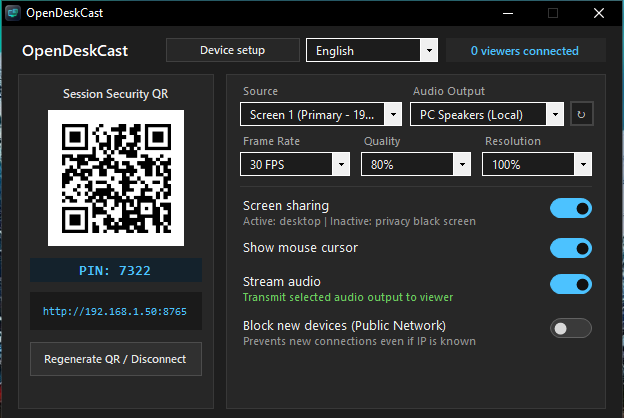

# OpenDeskCast

OpenDeskCast is an open-source, cross-platform desktop application (Windows, Linux, macOS) designed for low-latency screen and audio streaming from a computer to any device equipped with a modern web browser (Chrome, Safari, Edge, Firefox, Brave).

<p align="center">
  
</p>

<p align="center">
  <b>English</b> | <a href="README_IT.md">Italiano</a>
</p>

---

## Key Features

- **Zero Installation for Viewers**: The viewer only needs to scan the QR Code or navigate to the local IP address displayed on screen.
- **Total Control from the Host PC**: All streaming parameters (display selection, FPS, quality, audio routing) are controlled exclusively from the host computer. The viewer functions as a passive receiver, just like an HDMI display.
- **True Multi-Monitor Support**: Automatically detects and lets you individually select any physical display connected to your computer.
- **Synchronized Audio Streaming**: When cast audio is enabled, system audio streams directly to the receiver while host PC speakers are cleanly muted; turning off cast audio restores host speakers instantly.
- **Protection from Unwanted Viewers**: Secured by default via session QR codes with cryptographic tokens or manual 4-digit PIN authentication.
- **Host Control Panel Restricted to Localhost**: Administrative APIs and configuration controls are completely inaccessible from the external network, guaranteeing full broadcast privacy.
- **Zero-Dependency Standalone Package**: No Python, .NET, or external runtimes required for end users.

---

## Installation & Usage

### Windows
1. Download the [**`OpenDeskCast-v1.0.5-windows-x64.msi`**](https://github.com/marco996/OpenDeskCast/releases/download/v1.0.5/OpenDeskCast-v1.0.5-windows-x64.msi) installer directly (or visit the [Releases](https://github.com/marco996/OpenDeskCast/releases) page).
2. Run the installer: automatically creates Start Menu and Desktop shortcuts.
3. Double-click **OpenDeskCast**: the control panel opens, showing the QR Code for viewers to connect.

### Linux (Ubuntu / Debian / Mint & Fedora / Wayland / Xorg)
- **Ubuntu / Debian / Mint (`.deb`)**:
  1. Download the [**`opendeskcast_1.0.5_amd64.deb`**](https://github.com/marco996/OpenDeskCast/releases/download/v1.0.5/opendeskcast_1.0.5_amd64.deb) package directly (or visit the [Releases](https://github.com/marco996/OpenDeskCast/releases) page).
  2. Install via terminal with a single command:
     ```bash
     sudo apt install ./opendeskcast_1.0.5_amd64.deb
     ```
  3. Launch **OpenDeskCast** from your application menu or by running `opendeskcast` in the terminal.
- **Fedora / RHEL / Arch (Wayland & Xorg)**:
  1. Run `./run_linux.sh` from the repository directory.
  2. Both **Wayland** (native XDG Desktop Portal + PipeWire screen & audio capture; select the screen and click *Share* when prompted by GNOME/KDE) and **Xorg** (`gnome-xorg`) are supported out of the box.

### macOS
1. Download the [**`OpenDeskCast-v1.0.5-macos.zip`**](https://github.com/marco996/OpenDeskCast/releases/download/v1.0.5/OpenDeskCast-v1.0.5-macos.zip) package directly (or visit the [Releases](https://github.com/marco996/OpenDeskCast/releases) page).
2. Extract the zip file and drag **OpenDeskCast.app** into your **Applications** folder.
3. Launch **OpenDeskCast** from Launchpad or Applications.
   *(If macOS blocks opening unverified apps, right-click the app and choose **Open**, or run: `xattr -cr /Applications/OpenDeskCast.app`)*

*(Alternatively, to run from source on macOS: `./run_macos.sh`)*

---

## License

Distributed under the **MIT** License. See [LICENSE](LICENSE) for full details.
